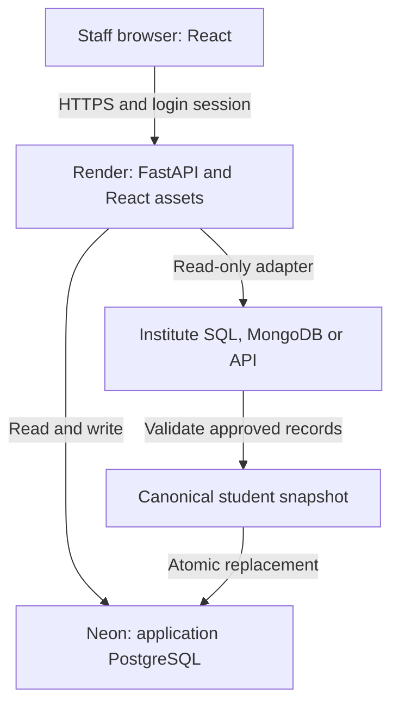

# Architecture and durable data

React is compiled by the Node build stage. FastAPI serves those static assets and the API from one Render web service. Same-origin HTTPS requests use a staff session cookie, so there is no frontend database credential or cross-origin API configuration to maintain.

The institute source and the app database have different jobs. The source owns institute records. Neon stores an approved canonical snapshot plus PULSEIQ-owned staff/workflow state. A refreshed snapshot makes the dashboard consistent across staff browsers and keeps rules independent of vendor-specific database schemas.

## Modules

| Module | Boundary |
|---|---|
| `main` | Request validation, authorization, HTTP responses, action revision events |
| `auth` | Password verification, session lookup, CSRF and department permissions |
| `connectors` | Read-only source fetch using server credentials and configured fields |
| `validation` | Canonical row types, ranges, duplicate keys, reporting dates and source joins |
| `repository` | Transactions, durable snapshot metadata and role-scoped scored records |
| `scoring` | Pure rules and scenario computation; no database mutation |
| `seed` | Fictional records, inserted once through the same validation path |
| `frontend` | Authenticated views, forms, charts, board stages and optimistic revision version |

## Tables

Canonical sources are `students`, `academic`, `attendance`, `lms`, `placement`, `skills`, `engagement`, `feedback`. The student table has a stable `student_id` primary key. All reporting tables have `(student_id, period_end)` primary keys and student foreign keys, plus source label/import timestamp.

PULSEIQ workflow tables are `pulseiq_users`, `pulseiq_sessions`, `pulseiq_login_attempts`, `interventions`, `intervention_history`, `sync_log` and `pulseiq_state`.

Each intervention has an immutable ID/student association, editable owner/action/due date/status/review note, timestamps and a numeric version. A revision update compares the submitted version with the stored version. A stale version returns HTTP 409. The new revision and its history event commit together. Reviewed/Closed require a review note. Reopening adds an event without deleting previous reviews.

History belongs to interventions through a foreign key. Snapshot refresh keeps removed student IDs as inactive roster identities so intervention history still has its parent student. Active student records feed the dashboard. Existing actions can be viewed/reviewed after a student leaves the current snapshot; new actions require an active student.

## Refresh transaction

Fetch source records → validate all sources → acquire transaction advisory lock → update active roster → replace seven reporting tables → save dataset metadata and success log → commit. Any validation error blocks before replacement. Database failures roll back the replacement. Existing interventions, history, users and sessions are not deleted. PostgreSQL snapshot reads use repeatable-read isolation so a refresh cannot mix old and new entity reads within a dashboard calculation.

The default mapping assumes one row per student/reporting period. It does not sum subject marks, select the newest arbitrary LMS event or aggregate attendance sessions. Provide approved normalized views for those cases. Periods are joined by exact date, never silently borrowed from another period.

## Authentication and transport

Passwords use Argon2 through `pwdlib`. Sessions use random opaque tokens; only HMAC token hashes are stored. Tokens are carried in HttpOnly, Secure, SameSite=Strict cookies for eight hours. The UI receives a CSRF token after login/session restoration and submits it in `X-CSRF-Token` on mutations. Cross-origin changes are rejected. API responses disable browser caching.

Roles: admin has institution-wide access and connector/user management. Faculty and placement staff have the same support workflow with department restrictions checked on the server for cohorts, profiles, scenarios, actions and history. A role change is not trusted from the browser. Login failure attempts are persisted and rate limited per username/client address.

This version provides initial staff creation and login/logout. It does not implement institute SSO, account self-service/password recovery, an immutable compliance ledger or separate student login. Each institute should use its own deployment/database and an appropriate staff account lifecycle.

## Deployment and change management

The Docker image runs one Uvicorn worker as an unprivileged container user. PostgreSQL connections have small bounded pools and reconnect checks. React has no production development server. No writable local data directory is needed.

Startup creates missing initial tables and records schema version 1. It does **not** alter existing table columns or provide automatic upgrade migrations. For future schema changes, add a reviewed migration and test it on a separate database branch before deploying. A code rollback also needs a compatible database schema; it does not restore database contents.

The service is stateless outside the shared database. Provider backups/restore policy are configured in Neon, not by browser exports. The current refresh model is a manually replaced snapshot, not incremental event streaming or automated synchronization.
